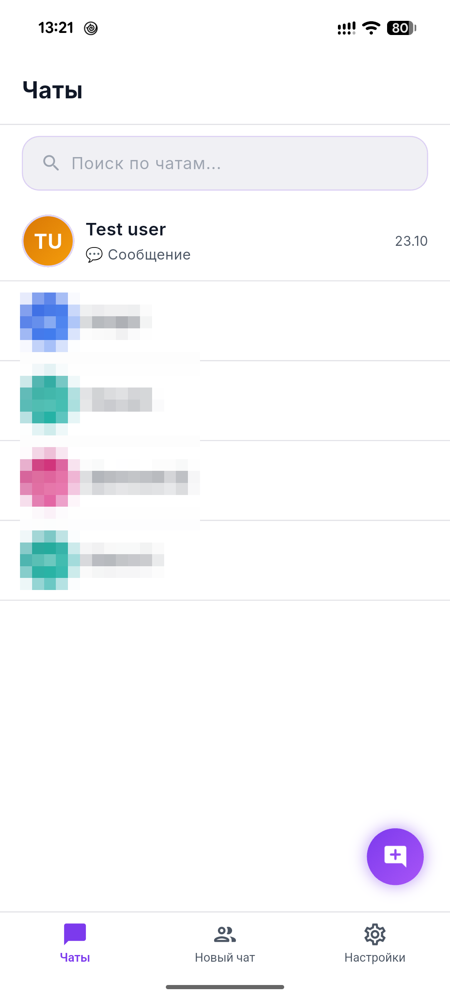
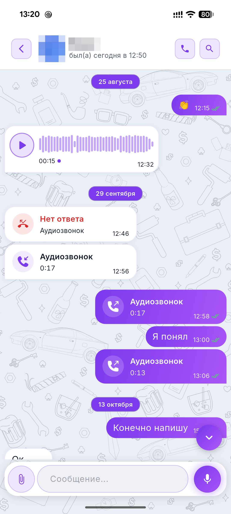
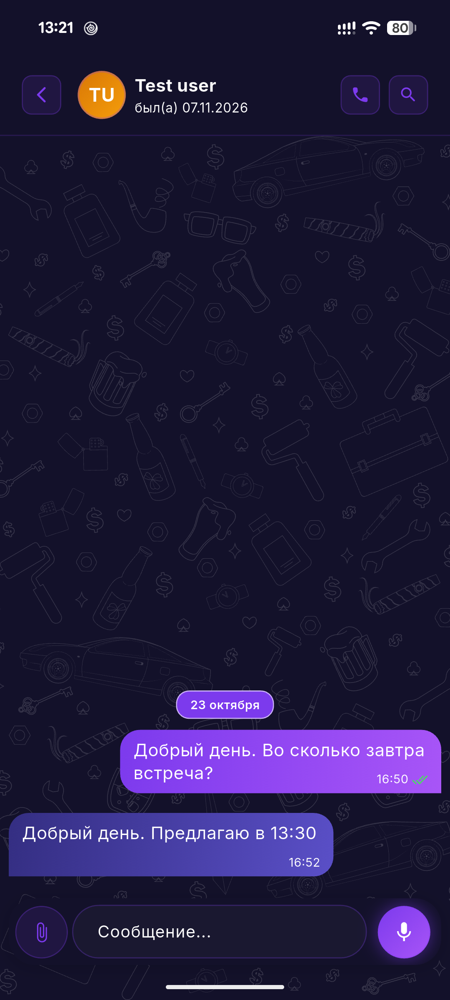
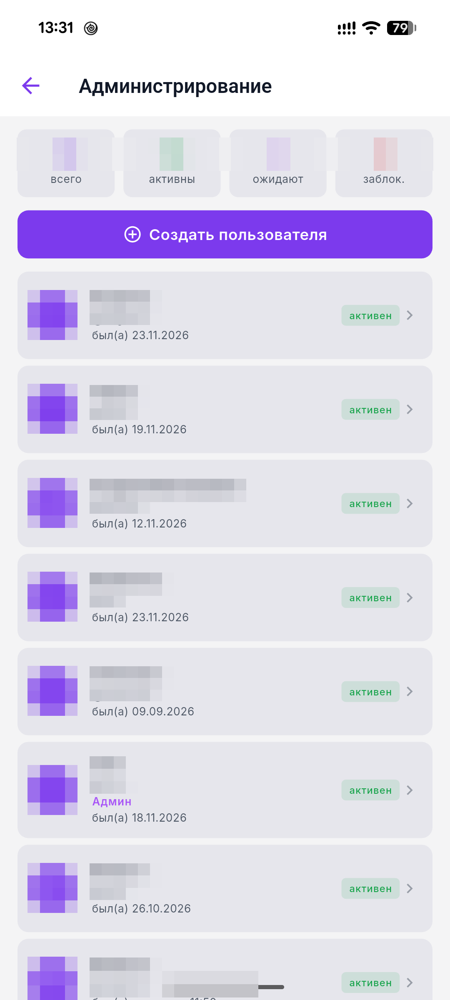
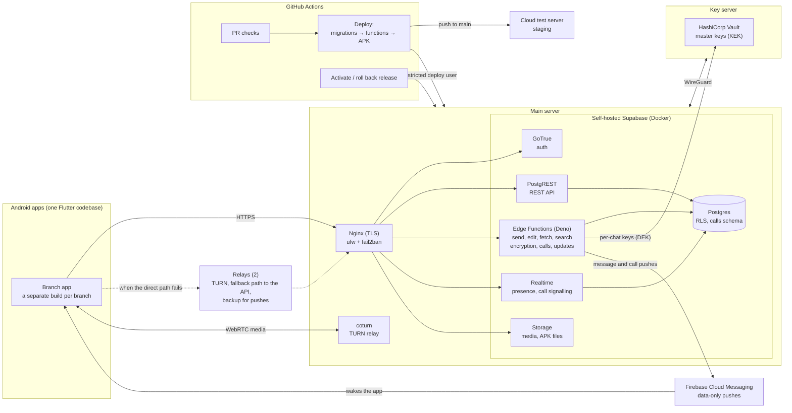
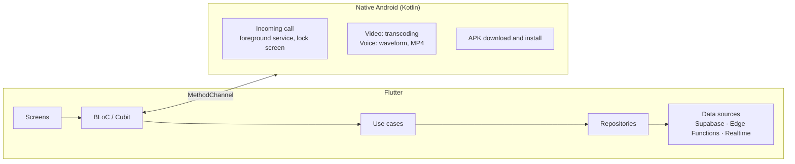
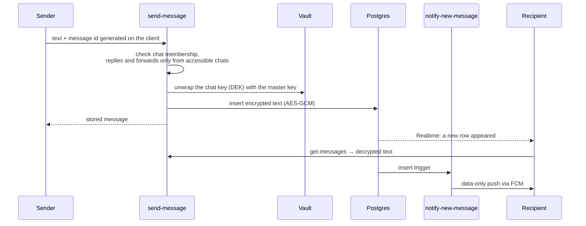
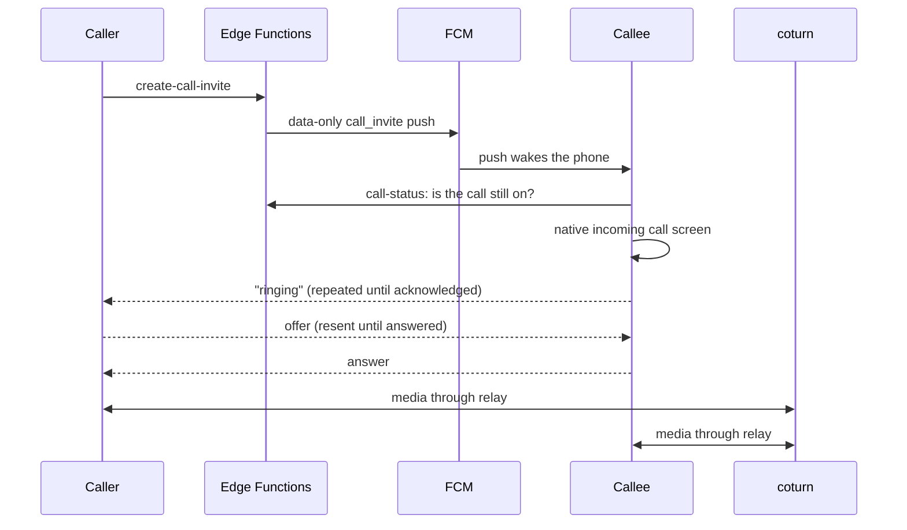
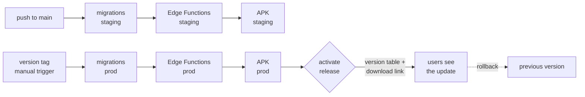

<div align="center">

# White-label Messenger

**A corporate messenger for companies and their branches: each branch gets its own isolated Android app, all built from one Flutter codebase. Self-hosted Supabase backend, server-side message encryption, WebRTC calls.**

[](https://flutter.dev)
[](https://dart.dev)
[](https://kotlinlang.org)
[](https://supabase.com)
[](https://www.postgresql.org)
[](https://deno.com)
[](https://webrtc.org)
[](https://www.vaultproject.io)
[](#testing-and-ci)
[](LICENSE)

Android 8.0+ · in production since September 2025 · private code

<a href="README.ru.md"></a>

</div>

> [!NOTE]
> This is a commercial project, so the code repository is private. Below is what was built and the decisions behind it. User names and logins are hidden in the screenshots.

## Demo

https://github.com/user-attachments/assets/5485c6e5-fabb-4a9a-b805-bd392f9d1882

## Screenshots

| | | | |
|:---:|:---:|:---:|:---:|
|  |  |  |  |
| Chat list with search | Chat | Dark theme | User administration |

## At a glance

| | |
|---|---|
| Dart client (generated code excluded) | ~61,000 lines |
| Native Kotlin code | ~2,300 lines |
| TypeScript Edge Functions | 26 functions, ~4,800 lines |
| SQL migrations | 43 files, ~5,200 lines |
| Tests | 1,100+ client, ~100 Edge Functions |
| GitHub Actions | 7 workflows |
| Commits | 1,400+ |
| Servers | 6: two physical, a cloud test server, a separate VPS, two relays |
| Infrastructure repo | Ansible, 16 roles, 190+ commits |
| Developers | 1, full stack |

## The task

The company needed its own messenger on its own servers instead of someone else's cloud service. Each branch needed a separate, isolated app with its own name, icon, colours, configuration and push project. All apps had to be built from one codebase, so a new feature reaches every branch at once.

The apps are not published in app stores. They ship as signed APKs, so update delivery had to be built in-house too.

One developer on the whole stack: mobile client, native plugins, backend, servers and the release pipeline. The project is now on monthly support.

## Features

### Messaging
- Personal and group chats: replies, forwarding, editing, pinned messages, drafts.
- Message search and link previews.
- Offline outbox: messages sent without a connection go out once it is back.
- Photos, videos and files with multipart upload. Videos are compressed on the phone ([how](#native-media-processing-on-the-phone)).
- Voice messages with a waveform. Playback continues in the background.
- Presence: online, "last seen", "typing", "recording", "uploading".

### Calls
- 1:1 audio calls on WebRTC through a self-hosted TURN server.
- Rings on the lock screen, even if the app was swiped away.
- Survives a network switch and a screen lock.
- Audio goes through the relay by default, so peers never see each other's IP.
- Call history in the chat: outgoing, incoming, missed, duration.

### Notifications
- Push for messages and calls via Firebase Cloud Messaging.
- A burst of messages arrives as one summary, not ten notifications.

### Security and access
- No self sign-up: a super admin issues accounts, and the sign-in token is shown once.
- Messages are encrypted on the server with a key per chat ([details](#server-side-encryption-with-keys-in-a-separate-store)).
- Row-level security in Postgres: a user sees only their own chats.
- Media is served through signed temporary links.
- A PIN code on top of the session. Input locks after three wrong attempts.

### Administration
- Two roles: super admin and admin.
- A user list with statuses: active, pending, blocked.
- Create accounts, reissue tokens, block users. A support chat.

### Builds and updates
- A separate app per branch and three environments: dev, staging, production.
- Each build has its own icons, colours and feature flags.
- Light and dark theme, Russian and English.
- One-tap in-app updates through a one-time signed link. Source, version and APK signature are checked before install.
- A release can be made mandatory. The first install goes through an invite link.

## What's not included

- **End-to-end encryption.** The server can decrypt messages. End-to-end encryption on an established library is in progress.
- **Video and group calls.** Calls are audio only and 1:1 only.
- **iOS.** The app is built for Android only.
- **Push on phones without Google services.** I chose not to bring back a permanent notification for everyone just for this rare case (why, see [below](#push-from-an-own-service-to-fcm-data-only-messages)).

## Architecture



### Client



The client is split by feature: auth, chats (list, room, groups, new chat, peer profile), calls, voice messages, media upload, PIN, updates, settings. Each feature has `data`, `domain` and `presentation` layers. State is BLoC, navigation is auto_route, dependencies go through get_it and injectable, models use freezed.

### How a message is sent



If the response to a send gets lost, the client retries with the same id. The server recognises the retry and returns the stored message, so there are no duplicates.

### How a call is set up



Signalling (dashed) goes over private Supabase Realtime channels.

## Key decisions

### Server-side encryption with keys in a separate store

**Problem:** a database leak must not expose the messages.

**Solution:**
- The client never writes to the messages table. Send, edit, fetch and search go through Edge Functions, and all the cryptography lives there.
- Each chat has its own data key (DEK), wrapped by a master key (KEK).
- The master key is kept in HashiCorp Vault on a separate server, reachable only over WireGuard.
- Link previews are encrypted together with the text.

> This is server-side encryption, not end-to-end. End-to-end encryption on an established library is in progress.

### Sign-in with an admin-issued token

**Problem:** only the company's own staff should be in the messenger.

**Solution:**
- No open sign-up. A super admin creates the account and hands over a sign-in token.
- The server shows the token once and keeps only its hash.
- Token and PIN hashes live in a separate table that clients cannot access at all.
- Sign-in attempts are rate-limited per IP. The IP is stored as an HMAC, because a plain SHA-256 of an IPv4 address can be brute-forced in hours.

### Push: from an own service to FCM data-only messages

**Problem:** the first version used a self-hosted push service. It needed a foreground service with a notification the user could not dismiss, and Android 15 limits made it unreliable.

**Solution:**
- Delivery moved to FCM data-only messages, the Signal-style pattern: the push has no visible content, the app builds the notification itself.
- A burst of messages is collected on the server and sent as one summary.
- A push FCM did not accept is retried every minute until it is no longer relevant.
- Incoming calls are handled by a native Kotlin plugin: a call-style notification with a ringtone right away, caller details from an encrypted cache on the device.

### A late call push does not ring

**Problem:** the phone may have been off, offline or in Doze, so a call push can arrive after the call has ended.

**Solution:**
- Before ringing, the native side asks the server whether the call is still on.
- The request works without a session, since the access token on a long-idle phone has already expired.
- It reveals one bit about one call, looked up by the random id from the push.

### Call signalling that survives a late peer

**Problem:** signalling goes over Supabase Realtime broadcast, which keeps no history. Anything sent before the other side subscribes is lost, and with calls that happens all the time.

**Solution:** every step is acknowledged.
- The callee repeats "ringing" until the caller reacts.
- The caller resends the current offer, and the callee answers a repeated offer again.
- An accepted call that does not connect in time ends on both sides instead of hanging.
- After a network switch (Wi-Fi → LTE) only the caller starts an ICE restart, so two restarts never collide.

### A calls schema ready for group calls

- A call is a row in the calls table plus rows in a separate participants table.
- The mode field already allows SFU next to peer-to-peer, so group calls can be added as a module.
- A unique index allows a user one active call at a time: a second call gets "busy" instead of a race.

### Native media processing on the phone

**Problem:** phone cameras shoot 4K, and sending that as is takes long and eats mobile data.

**Solution:**
- Video is transcoded in Kotlin on the hardware codec: scaled down to 1080p, bitrate capped by resolution.
- A video that already fits is sent untouched, since compressing it again only loses quality.
- Voice is recorded as AAC with a header on every frame, so even a recording cut off mid-way is readable.
- Before sending, voice is repackaged into MP4 without re-encoding.

### Releases that keep old APKs working

**Problem:** without a store, people update when they feel like it, and some stay on an old version for a long time.

**Solution:**
- Migrations only expand the schema: new tables, new columns with defaults. Nothing an old client reads is dropped or renamed.
- Deploy and release are separate steps:



- Each chain runs strictly in order and stops at the first failure.
- Users see a new version only after "activate release", which switches the version table and the download link together. Rollback switches both back.

### A locked-down server side

- TURN cannot reach internal networks, has per-user quotas and accepts only short-lived credentials.
- Servers talk to each other over WireGuard.
- CI deploys as a separate user with restricted permissions.

## Security

| Threat | Measure |
|---|---|
| Database leak | Message text is encrypted with AES-GCM using the chat key; chat keys are wrapped by a master key from Vault on another server |
| Access to other people's chats | RLS in Postgres; the client never writes to the messages table directly; replies and forwards are checked for access to the source chat |
| Stolen sign-in token | Only a SHA-256 hash in a table with no client access; an admin reissues the token or blocks the user |
| Token brute force | Per-IP attempt limits, the IP stored as an HMAC |
| Someone else holding the phone | PIN on top of the session, PBKDF2 hash on the server, input locked after three mistakes |
| IP address leaking in a call | Media goes through the TURN relay only by default |
| TURN abuse | Short-lived credentials, per-user quotas, no access to internal networks |
| Tampered APK | Source, version and signature checked before install; one-time download links with an hourly limit |
| Servers | ufw, fail2ban, WireGuard between servers, deploy as a restricted user, secret scan on every PR |

## Edge Functions

All logic the client can't be trusted with lives in 26 Deno functions.

| Area | Functions |
|---|---|
| Messages | `send-message`, `edit-message`, `get-messages`, `search-messages`, `fetch-link-preview`, `init-chat-key` |
| Media | `multipart-upload` |
| Calls | `create-call-invite`, `call-status`, `get-turn-credentials`, `notify-call-invite`, `notify-call-cancel` |
| Notifications | `notify-new-message`, `flush-notifications`, `test-notification` |
| Sign-in and protection | `auth-token`, `pin-set`, `pin-verify` |
| Administration | `admin-create-user`, `admin-reset-token`, `admin-set-admin`, `admin-set-blocked` |
| Updates | `check-update`, `request-download`, `download-app` |
| Service | `health` |

## Infrastructure

### Servers

| Server | What runs there |
|---|---|
| Main (physical) | Supabase in Docker, Nginx, coturn, GlitchTip, deploy target |
| Key server (physical) | HashiCorp Vault, receives encrypted backups. Reachable only over WireGuard |
| Cloud test server | The whole staging on one machine (Supabase + Vault), central monitoring |
| Separate VPS | One of the apps: Supabase, Vault, error tracking and backups on one machine |
| Two relays (rented) | TURN for calls, a fallback path to the API, a backup channel for pushes |

### Relays

The rented machines run nothing but coturn, baseline hardening and two forwarders. Even if one is compromised, it gives away almost nothing.

- **Calls.** Its own TURN server with its own secret, so a stolen secret does not open the main server's TURN. The app picks a server that suits both peers.
- **Fallback path to the API.** If a user's direct path to the server fails, the app goes through a relay. It forwards TCP by server name (SNI) without terminating TLS: there are no keys or certificates on the machine, and it never sees the content.
- **Backup for pushes.** If the main server cannot reach FCM directly, it goes to Google through a WireGuard tunnel to a relay. A proxy there allows only Google addresses on port 443, and encryption runs end to end up to Google.
- Machine names are neutral, each has its own SSH key, and monitoring checks them from outside.

### Infrastructure as code

The servers are described in a separate private **Ansible** repository: 16 roles and one playbook for everything, from baseline hardening to the office router.

| Roles | What they do |
|---|---|
| `common`, `security` | Baseline setup, SSH with no passwords and no root login, ufw, fail2ban |
| `docker_firewall` | Closes ports Docker publishes past ufw |
| `nginx`, `supabase`, `hashicorp_vault`, `coturn` | The main stack |
| `cd_user`, `apk_download` | A CI deploy user allowed to run only specific scripts; APK hosting |
| `api_relay`, `push_relay` | API and push relays |
| `diag`, `uptime_kuma`, `glitchtip` | Monitoring and error tracking |
| `backups` | GPG-encrypted nightly dumps shipped to the key server |
| `mikrotik_config` | MikroTik router setup: port forwarding, priority for call traffic |

- The same roles build both layouts: production on two machines (main + keys) and everything on one machine (staging and the separate VPS).
- Secrets are encrypted with Ansible Vault, and every PR gets a secret scan (gitleaks).
- Runbooks for production rollout and Docker image rollback live next to the code.

### Monitoring

- An agent on every server sends a heartbeat to a central diagnostics hub. The hub makes a verdict, shows it in Uptime Kuma and can send alerts to Telegram.
- It works the other way too: if the hub itself goes silent, the main server reports it.
- GlitchTip collects client errors.
- A call delivery funnel ("rang", "answered", "connected"): a call that never rang leaves no error on the phone, but it shows up here.

## Testing and CI

- Over 1,100 Flutter client tests: BLoCs, repositories, data parsing, call logic.
- About 100 Deno tests for Edge Functions: cryptography, the encrypted text format, Vault, FCM, presence, caching.
- On every pull request: secret scan, static analysis, tests, and a run of all migrations on an empty database.
- Weekly dependency updates.
- Seven workflows: PR checks, migration check, database deploy, functions deploy, app deploy, release activation, rollback.

## Tech stack

| Area | Technologies |
|---|---|
| Client | Flutter, Dart 3.11, `flutter_bloc`, `auto_route`, `get_it` + `injectable`, `freezed`, `supabase_flutter`, `flutter_secure_storage`, `shared_preferences`, `connectivity_plus` |
| Media | `image_picker`, `file_picker`, `video_player`, `cached_network_image`, native video transcoding in Kotlin |
| Calls and voice | `flutter_webrtc`, coturn, `record`, `just_audio`, `audio_service` |
| Notifications | Firebase Cloud Messaging (data-only), `flutter_local_notifications`, a native Kotlin plugin for incoming calls |
| Backend | Self-hosted Supabase: Postgres with RLS, PostgREST, GoTrue, Realtime, Storage, Edge Functions on Deno |
| Security | HashiCorp Vault, AES-GCM with DEK/KEK keys, PBKDF2, WireGuard, ufw, fail2ban |
| Infrastructure | Ansible (separate repo), Ansible Vault, Docker, Nginx, MikroTik RouterOS, Uptime Kuma, GlitchTip (Sentry SDK), GPG-encrypted backups |
| CI/CD | GitHub Actions |
| Localisation | Russian, English (ARB) |

## Project structure

```
.
├── frontend/
│   ├── lib/
│   │   ├── core/                # DI, network, theme, l10n, presence, observability, version
│   │   └── features/
│   │       ├── auth/            # token sign-in
│   │       ├── chat/            # list, room, groups, new chat, peer profile
│   │       ├── calls/           # WebRTC, signalling, call screen
│   │       ├── voice_message/   # recording and playback
│   │       ├── media_upload/    # multipart upload
│   │       ├── pin/             # PIN code
│   │       ├── app_update/      # check, download, install
│   │       └── settings/
│   ├── android/                 # native Kotlin plugins: calls, video, voice, APK
│   └── test/
├── supabase/
│   ├── functions/               # 26 Edge Functions + shared code (_shared)
│   └── migrations/              # 43 migrations, expand-only
├── docker/                      # docker-compose, coturn
├── vault/                       # docker-compose and Vault configuration
└── .github/workflows/           # 7 workflows: checks, deploy, activation, rollback
```

## What's next

- End-to-end encryption on an established library is in progress.
- Terraform may join Ansible in the infrastructure repository to create the servers themselves.

## License

All rights reserved. The code is private; the texts and images here may not be reused without permission. See [LICENSE](LICENSE).
