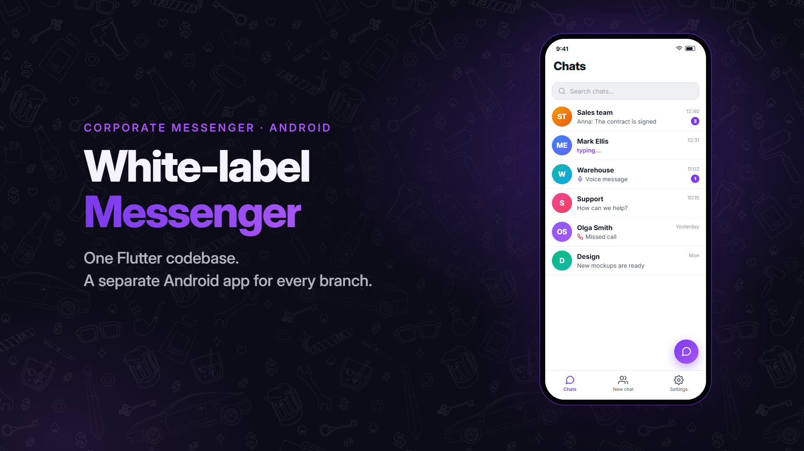
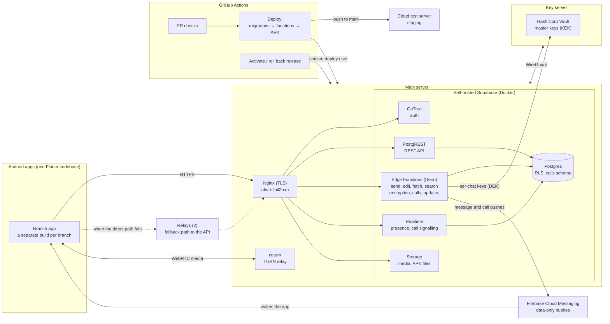
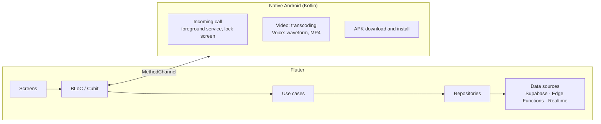
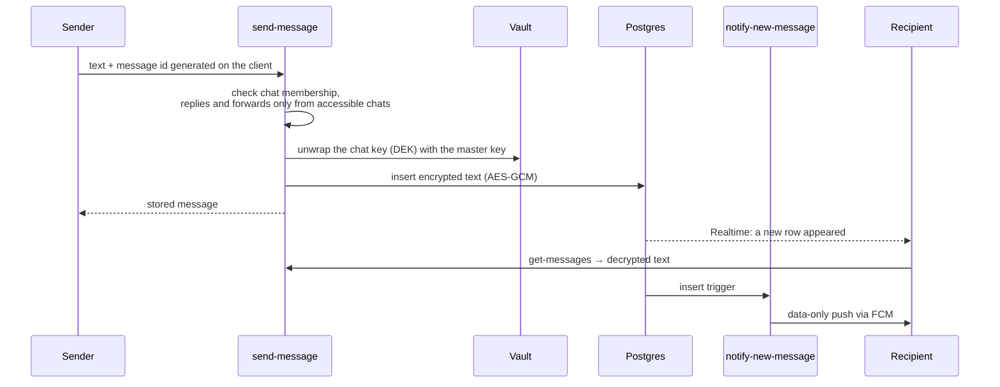
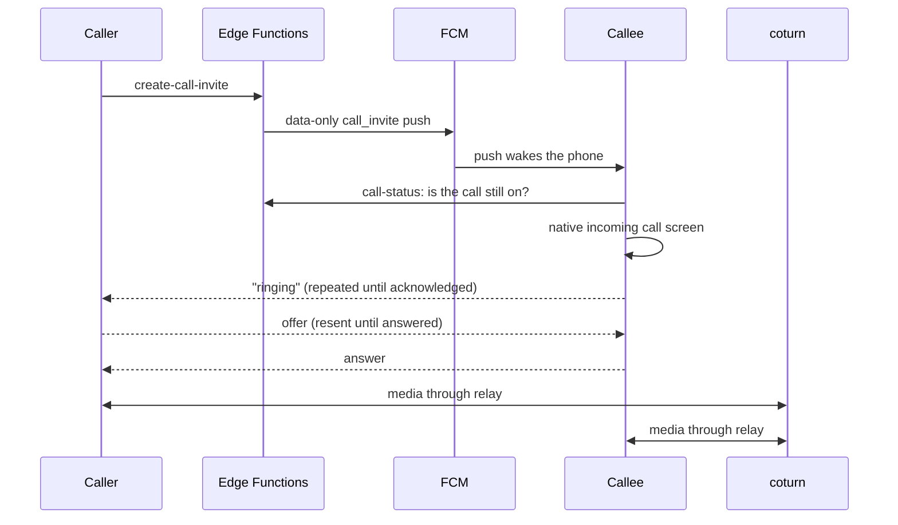
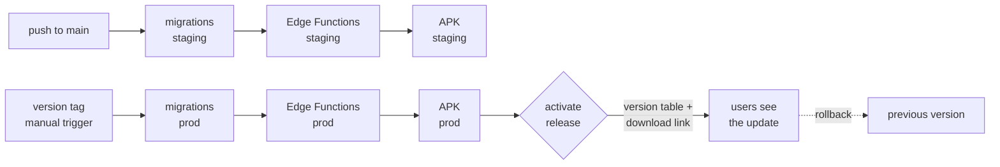

<div align="center">

# White-label Messenger

**A corporate messenger for companies and their branches: each branch gets its own isolated Android app, all built from one Flutter codebase. Self-hosted Supabase backend, server-side message encryption, WebRTC calls.**

[](https://flutter.dev)
[](https://dart.dev)
[](https://kotlinlang.org)
[](https://supabase.com)
[](https://www.postgresql.org)
[](https://deno.com)
[](https://webrtc.org)
[](https://www.vaultproject.io)
[](#testing-and-ci)

Android 8.0+ · in production since September 2025 · private code

**English** · [Русский](README.ru.md)

</div>

<!-- TODO: banner -->

> [!NOTE]
> This is a commercial project, so the code repository is private. Below is what was built and the decisions behind it. User names and logins are hidden in the screenshots.

## Demo

<!-- TODO: on GitHub (Edit), delete the image line below and drag
     videos/messenger/slim/promo.mp4 in its place. GitHub inserts a user-attachments link with an inline player. -->


## Screenshots

| | | | |
|:---:|:---:|:---:|:---:|
|  |  |  |  |
| Chat list with search | Chat | Dark theme | User administration |

## At a glance

| | |
|---|---|
| Dart client (generated code excluded) | ~61,000 lines |
| Native Kotlin code | ~2,300 lines |
| TypeScript Edge Functions | 26 functions, ~4,800 lines |
| SQL migrations | 43 files, ~5,200 lines |
| Tests | 1,100+ client, ~100 Edge Functions |
| GitHub Actions | 7 workflows |
| Commits | 1,400+ |
| Servers | 6: two physical, a cloud test server, a separate VPS, two relays |
| Developers | 1, full stack |

## The task

The company needed its own messenger on its own servers instead of someone else's cloud service. Each branch needed a separate, isolated app with its own name, icon, colours, configuration and push project. All apps had to be built from one codebase, so a new feature reaches every branch at once.

The apps are not published in app stores. They ship as signed APKs, so update delivery had to be built in-house too.

One developer on the whole stack: mobile client, native plugins, backend, servers and the release pipeline. The project is now on monthly support.

## Features

**Accounts are issued by an admin.** There is no self sign-up. A super admin creates an account, and the server shows the sign-in token once. The database keeps only its SHA-256 hash, in a separate table closed to everything except the service role. An admin can reissue a lost token or block a user.

**Chats.** Personal and group chats, replies, forwarding, editing, pinned messages, link previews, drafts, message search. Messages sent while offline wait in an outbox and go out when the connection is back.

**Media.** Photos, videos and files with multipart upload. Videos are compressed on the phone by native code: anything above 1080p is scaled down, and a clip that is already H.264, at most 1080p and within the bitrate budget is sent untouched. Media is served through signed temporary links.

**Voice messages.** Recording with a waveform, computed natively from the audio. Playback continues when the app is in the background. Recording uses a format that stays readable even if it was cut off mid-way, and before sending it is repackaged into MP4 without re-encoding, so every client version can play it.

**Presence.** Online status, "last seen", and "typing", "recording" and "uploading" indicators.

**1:1 audio calls.** WebRTC through a self-hosted TURN server. An incoming call rings on the lock screen even if the app was swiped away from recents. A call survives a network switch and a screen lock. By default audio goes through the relay only, so the two sides never see each other's IP address. The chat keeps call history: outgoing, incoming, missed, duration.

**Push notifications.** For messages and calls, via Firebase Cloud Messaging. When messages arrive in a burst, the recipient gets one summary instead of ten notifications in a row.

**Encryption and access.** Message content is encrypted on the server with a separate key per chat. Row-level security in Postgres lets a user into their own chats only. Details in [Key decisions](#key-decisions).

**PIN code.** A separate PIN on top of the account session. It is checked on the server and stored as a PBKDF2 hash. After three wrong attempts input is locked for a while.

**Administration.** Two roles, super admin and admin, with different permissions. A user list with statuses (active, pending, blocked), account creation, token reissue, blocking. A support chat.

**Look and language.** Light and dark theme, Russian and English.

**White-label builds.** One app per branch and three environments (dev, staging, production). Each build has its own icons, colours and feature flags.

**Own update system.** The app finds a new version, downloads it through a one-time signed link and installs it in one tap. Before installing, it checks the source, the version number and the APK signature. A release can be made mandatory, which blocks older versions. The first install goes through an invite link.

## What's not included

- **End-to-end encryption.** The server can decrypt messages. End-to-end encryption on an established library is in progress.
- **Video and group calls.** Calls are audio only and 1:1 only.
- **iOS.** The app is built for Android only.
- **Push on phones without Google services.** I chose not to bring back a permanent notification for everyone just for this rare case (why, see [below](#push-from-an-own-service-to-fcm-data-only-messages)).

## Architecture



### Client



The client is split by feature: auth, chats (list, room, groups, new chat, peer profile), calls, voice messages, media upload, PIN, updates, settings. Each feature has `data`, `domain` and `presentation` layers. State is BLoC, navigation is auto_route, dependencies go through get_it and injectable, models use freezed.

### How a message is sent



If the response to a send gets lost, the client retries with the same id. The server recognises the retry and returns the stored message, so there are no duplicates.

### How a call is set up



Signalling (dashed) goes over private Supabase Realtime channels.

## Key decisions

### Server-side encryption with keys in a separate store

The client never writes to the messages table directly. Sending, editing, fetching and searching go through Edge Functions, and all the cryptography lives there. Each chat has its own data key (DEK), wrapped by a master key (KEK). The master key is kept in HashiCorp Vault on a separate server that is reachable only over WireGuard. A database leak on its own does not expose the messages. Link previews are stored inside the encrypted text, not next to it.

This is server-side encryption, not end-to-end. End-to-end encryption on an established library is in progress.

### Sign-in with an admin-issued token

The company does not need open sign-up: only its own staff should be in the messenger. So accounts are created by a super admin, and a person signs in with the token they were given. The server shows the token once and keeps only a hash. Profile secrets (token and PIN hashes) live in a separate table that clients cannot access at all. Sign-in attempts are rate-limited per IP, and the IP is stored as an HMAC: a plain SHA-256 of an IPv4 address can be brute-forced in hours.

### Push: from an own service to FCM data-only messages

In the first version notifications came through a self-hosted push service. That needed a foreground service running on the phone all the time, with a notification the user cannot dismiss, and the foreground-service limits in Android 15 made this setup unreliable. I moved delivery to FCM data-only messages, the Signal-style pattern: the push carries no visible content, and the app builds the notification itself.

Messages that arrive in a burst are collected on the server and sent as one summary once the stream goes quiet. A push FCM did not accept stays queued and is retried every minute until it is no longer relevant.

Incoming calls are handled by a native Kotlin plugin. It shows a call-style notification with a ringtone right away and reads the caller's details from an encrypted cache on the device. The Flutter background handler is only a fallback.

### A late call push does not ring

The phone may have been off, offline or in Doze mode, so a call push can arrive after the call has ended. Before showing an incoming call, the native side asks the server whether the call is still on. The request works without a session (on a phone that hasn't been opened for a while the access token has already expired) and exposes exactly one bit about one call, looked up by the random id from the push.

### Call signalling that survives a late peer

Signalling goes over Supabase Realtime broadcast channels that are closed to everyone except the call participants. Broadcast keeps no history: anything sent before the other side subscribes is lost. With calls this happens all the time: the callee answers from the lock screen after the app was killed, or their phone starts ringing before the caller has opened their channel.

So every step is acknowledged. The callee repeats "ringing" until the caller reacts. The caller resends the current offer for a while, and the callee answers a repeated offer again. If a call was accepted but did not connect in time, it ends on both sides instead of hanging. If the connection drops mid-call, for example when switching from Wi-Fi to LTE, only the caller starts an ICE restart, so two restarts never collide.

### A calls schema ready for group calls

A call is a row in the calls table plus rows in a separate participants table, and the mode field already allows SFU next to peer-to-peer. Group calls can be added as a module without reworking the schema. A unique index allows a user only one active call, so a second simultaneous call gets "busy" instead of a race.

### Native media processing on the phone

Phone cameras record in 4K, and sending that as is takes long and costs mobile data. Transcoding is written in Kotlin on the hardware codec: the clip is scaled down to 1080p and the bitrate is capped by resolution. If a video already fits, it is sent untouched: compressing it again would only lose quality and make the file bigger.

Voice is recorded as AAC with a header on every frame, so even a recording cut off mid-way can be read. Before sending it is repackaged into MP4 without re-encoding, and a truncated last frame is dropped.

### Releases that keep old APKs working

Without a store, people update when they feel like it, and some stay on an old version for a long time. So database migrations only expand the schema: new tables, new columns with a default value. Nothing an old client may read is dropped or renamed. Messages stored before a new format appeared are read as before.

Deploy and release are separate:



Each chain runs strictly in order and stops at the first failure. Users see a new version only after a separate "activate release" step, which switches the version table and the download link together. A rollback workflow switches both back.

### A locked-down server side

The TURN server cannot reach internal networks, has per-user quotas and accepts only short-lived credentials. The servers talk to each other over WireGuard. CI deploys as a separate user with restricted permissions.

## Security

| Threat | Measure |
|---|---|
| Database leak | Message text is encrypted with AES-GCM using the chat key; chat keys are wrapped by a master key from Vault on another server |
| Access to other people's chats | RLS in Postgres; the client never writes to the messages table directly; replies and forwards are checked for access to the source chat |
| Stolen sign-in token | Only a SHA-256 hash in a table with no client access; an admin reissues the token or blocks the user |
| Token brute force | Per-IP attempt limits, the IP stored as an HMAC |
| Someone else holding the phone | PIN on top of the session, PBKDF2 hash on the server, input locked after three mistakes |
| IP address leaking in a call | Media goes through the TURN relay only by default |
| TURN abuse | Short-lived credentials, per-user quotas, no access to internal networks |
| Tampered APK | Source, version and signature checked before install; one-time download links with an hourly limit |
| Servers | ufw, fail2ban, WireGuard between servers, deploy as a restricted user, secret scan on every PR |

## Edge Functions

All logic the client can't be trusted with lives in 26 Deno functions.

| Area | Functions |
|---|---|
| Messages | `send-message`, `edit-message`, `get-messages`, `search-messages`, `fetch-link-preview`, `init-chat-key` |
| Media | `multipart-upload` |
| Calls | `create-call-invite`, `call-status`, `get-turn-credentials`, `notify-call-invite`, `notify-call-cancel` |
| Notifications | `notify-new-message`, `flush-notifications`, `test-notification` |
| Sign-in and protection | `auth-token`, `pin-set`, `pin-verify` |
| Administration | `admin-create-user`, `admin-reset-token`, `admin-set-admin`, `admin-set-blocked` |
| Updates | `check-update`, `request-download`, `download-app` |
| Service | `health` |

## Infrastructure

- Two physical production servers, the main one and the key server, connected by WireGuard. Docker and Nginx behind ufw and fail2ban.
- A cloud test server for staging: every push to `main` lands here before a release reaches production.
- A separate VPS for one of the apps.
- Two relays: if a user's direct path to the server fails, the app reaches the API through them.
- Self-hosted Supabase: Postgres, PostgREST, GoTrue, Realtime, Storage, Edge Functions on Deno.
- HashiCorp Vault for keys, coturn for TURN.
- Uptime Kuma watches availability, GlitchTip collects client errors. The server also keeps a call delivery funnel ("rang", "answered", "connected"): a call that never rang leaves no error on the phone, but it shows up here.
- Encrypted nightly backups.
- Server configuration is moving to Ansible roles.

## Testing and CI

- Over 1,100 Flutter client tests: BLoCs, repositories, data parsing, call logic.
- About 100 Deno tests for Edge Functions: cryptography, the encrypted text format, Vault, FCM, presence, caching.
- On every pull request: secret scan, static analysis, tests, and a run of all migrations on an empty database.
- Weekly dependency updates.
- Seven workflows: PR checks, migration check, database deploy, functions deploy, app deploy, release activation, rollback.

## Tech stack

| Area | Technologies |
|---|---|
| Client | Flutter, Dart 3.11, `flutter_bloc`, `auto_route`, `get_it` + `injectable`, `freezed`, `supabase_flutter`, `flutter_secure_storage`, `shared_preferences`, `connectivity_plus` |
| Media | `image_picker`, `file_picker`, `video_player`, `cached_network_image`, native video transcoding in Kotlin |
| Calls and voice | `flutter_webrtc`, coturn, `record`, `just_audio`, `audio_service` |
| Notifications | Firebase Cloud Messaging (data-only), `flutter_local_notifications`, a native Kotlin plugin for incoming calls |
| Backend | Self-hosted Supabase: Postgres with RLS, PostgREST, GoTrue, Realtime, Storage, Edge Functions on Deno |
| Security | HashiCorp Vault, AES-GCM with DEK/KEK keys, PBKDF2, WireGuard, ufw, fail2ban |
| Infrastructure | Docker, Nginx, Uptime Kuma, GlitchTip (Sentry SDK), encrypted backups, Ansible |
| CI/CD | GitHub Actions |
| Localisation | Russian, English (ARB) |

## Project structure

```
.
├── frontend/
│   ├── lib/
│   │   ├── core/                # DI, network, theme, l10n, presence, observability, version
│   │   └── features/
│   │       ├── auth/            # token sign-in
│   │       ├── chat/            # list, room, groups, new chat, peer profile
│   │       ├── calls/           # WebRTC, signalling, call screen
│   │       ├── voice_message/   # recording and playback
│   │       ├── media_upload/    # multipart upload
│   │       ├── pin/             # PIN code
│   │       ├── app_update/      # check, download, install
│   │       └── settings/
│   ├── android/                 # native Kotlin plugins: calls, video, voice, APK
│   └── test/
├── supabase/
│   ├── functions/               # 26 Edge Functions + shared code (_shared)
│   └── migrations/              # 43 migrations, expand-only
├── docker/                      # docker-compose, coturn
├── vault/                       # docker-compose and Vault configuration
└── .github/workflows/           # 7 workflows: checks, deploy, activation, rollback
```

## What's next

End-to-end encryption on an established library is in progress.
