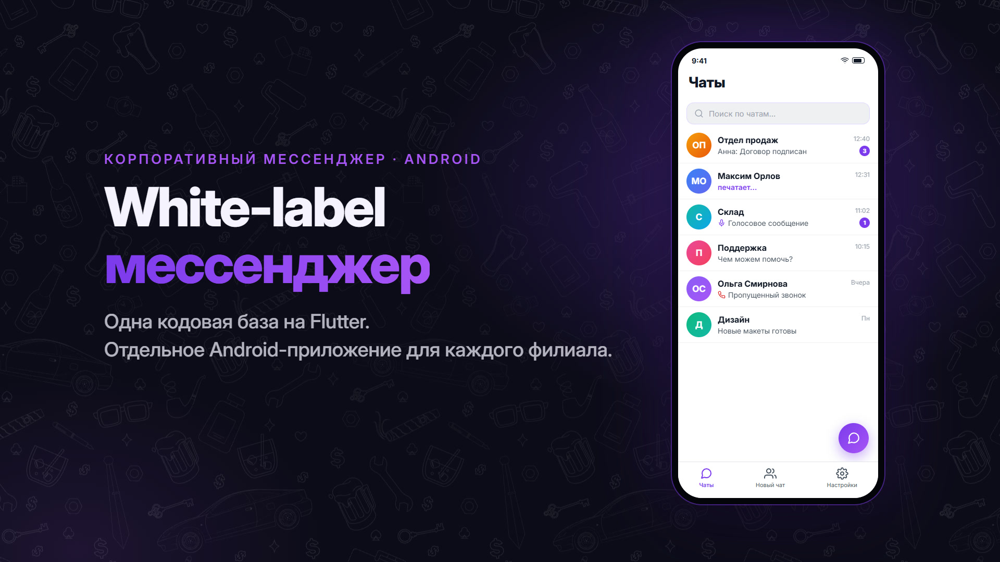
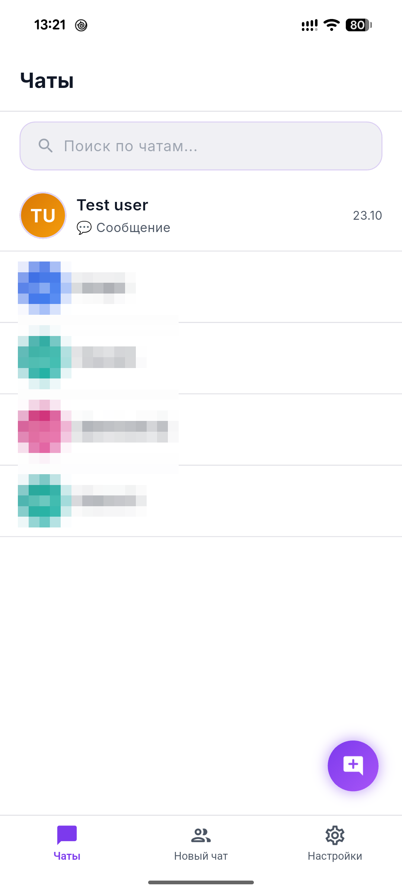
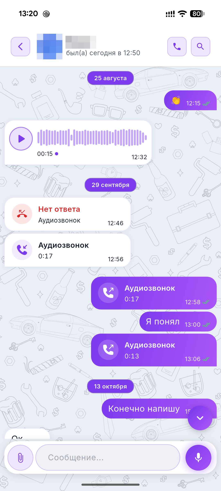
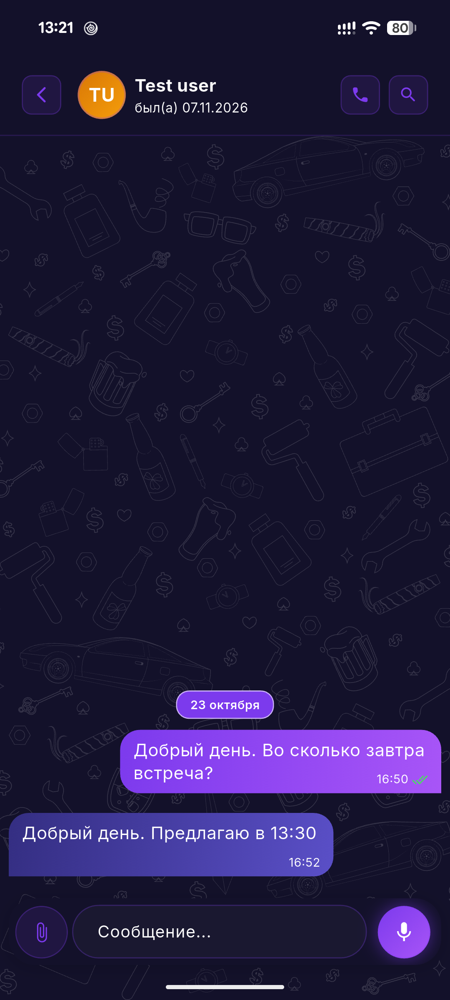
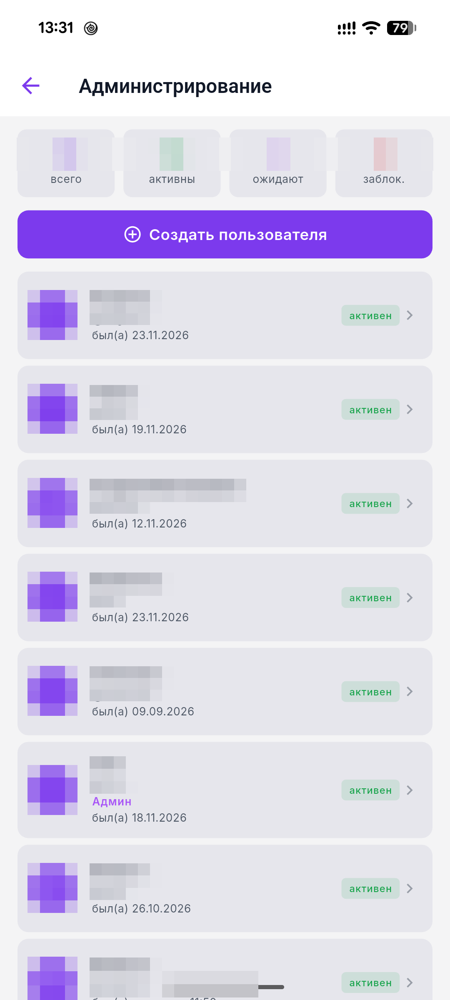
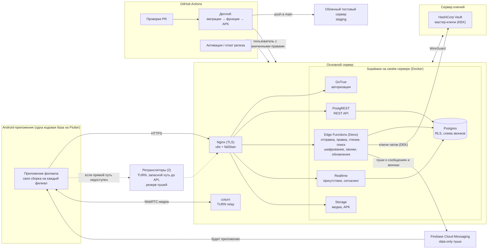
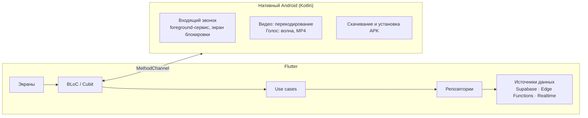
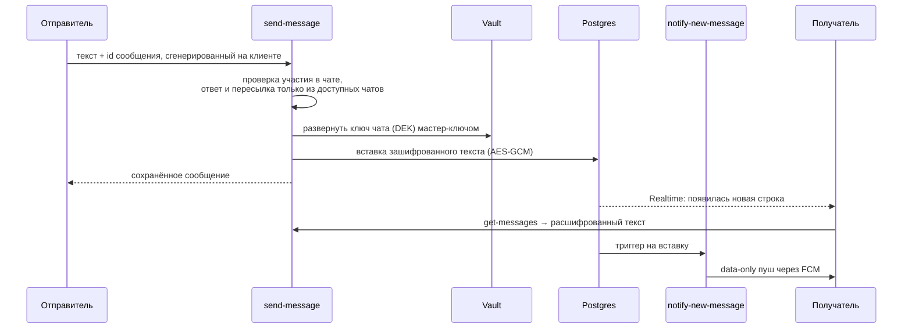
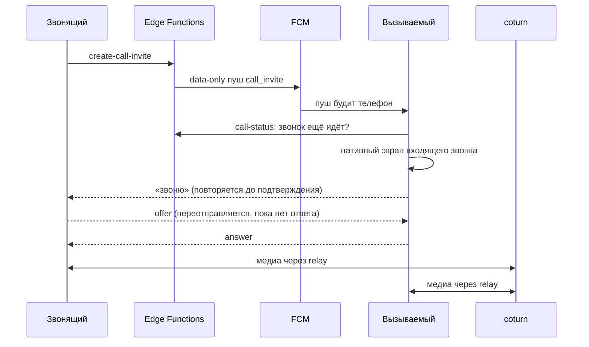
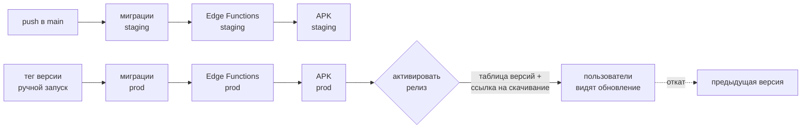

<div align="center">

# White-label Messenger

**Корпоративный мессенджер для компаний и их филиалов: у каждого филиала своё изолированное Android-приложение, все собираются из одной кодовой базы на Flutter. Бэкенд на Supabase на собственных серверах, шифрование сообщений на сервере, звонки на WebRTC.**

[](https://flutter.dev)
[](https://dart.dev)
[](https://kotlinlang.org)
[](https://supabase.com)
[](https://www.postgresql.org)
[](https://deno.com)
[](https://webrtc.org)
[](https://www.vaultproject.io)
[](#тестирование-и-ci)
[](LICENSE)

Android 8.0+ · в продакшене с сентября 2025 года · код закрыт

[English](README.md) · **Русский**

</div>

> [!NOTE]
> Это коммерческий проект, поэтому репозиторий с кодом закрыт. Ниже описано, что сделано и какие решения за этим стоят. На скриншотах имена и логины пользователей скрыты.

## Демо

<!-- TODO: на GitHub (Edit) удалите строку с картинкой ниже и перетащите на её место
     videos/messenger/slim/promo.ru.mp4. GitHub вставит ссылку user-attachments со встроенным плеером. -->


## Скриншоты

| | | | |
|:---:|:---:|:---:|:---:|
|  |  |  |  |
| Список чатов с поиском | Чат | Тёмная тема | Администрирование пользователей |

## Коротко в цифрах

| | |
|---|---|
| Клиент на Dart (без сгенерированного кода) | ~61 000 строк |
| Нативный код на Kotlin | ~2 300 строк |
| Edge Functions на TypeScript | 26 функций, ~4 800 строк |
| SQL-миграции | 43 файла, ~5 200 строк |
| Тесты | 1 100+ на клиенте, ~100 на Edge Functions |
| GitHub Actions | 7 workflow |
| Коммиты | 1 400+ |
| Серверы | 6: два физических, облачный тестовый, отдельный VPS, два ретранслятора |
| Инфраструктурный репозиторий | Ansible, 16 ролей, 190+ коммитов |
| Разработчики | 1, весь стек |

## Задача

Компании нужен свой мессенджер на своих серверах, а не чужой облачный сервис. Каждому филиалу требуется отдельное изолированное приложение: своё название, иконка, цвета, конфигурация и проект для пушей. Все приложения должны собираться из одной кодовой базы, чтобы новая функция появлялась у всех филиалов сразу.

Приложения не публикуются в сторах и распространяются подписанными APK, поэтому доставку обновлений тоже нужно было сделать самому.

Разработчик один, на всём стеке: мобильный клиент, нативные плагины, бэкенд, серверы и релизный конвейер. Сейчас проект на ежемесячной поддержке.

## Что умеет мессенджер

### Сообщения
- Личные и групповые чаты: ответы, пересылка, редактирование, закреплённые сообщения, черновики.
- Поиск по сообщениям и превью ссылок.
- Исходящая очередь: сообщения, отправленные без сети, уходят, когда связь вернётся.
- Фото, видео и файлы с загрузкой по частям. Видео сжимается на телефоне ([как](#медиа-обрабатываются-на-телефоне-нативно)).
- Голосовые сообщения с волной. Воспроизведение продолжается в фоне.
- Присутствие: в сети, «был(а) в сети», «печатает», «записывает», «загружает».

### Звонки
- Аудиозвонки 1:1 на WebRTC через собственный TURN-сервер.
- Звонит на заблокированном экране, даже если приложение смахнули из недавних.
- Переживает смену сети и блокировку экрана.
- По умолчанию звук идёт через relay, и собеседники не видят IP-адреса друг друга.
- История звонков в чате: исходящие, входящие, пропущенные, длительность.

### Уведомления
- Пуши о сообщениях и звонках через Firebase Cloud Messaging.
- Пачка сообщений приходит одной сводкой, а не десятью уведомлениями.

### Безопасность и доступ
- Самостоятельной регистрации нет: аккаунты выдаёт суперадминистратор, токен для входа показывается один раз.
- Сообщения шифруются на сервере, у каждого чата свой ключ ([подробнее](#шифрование-на-сервере-ключи-в-отдельном-хранилище)).
- Row-level security в Postgres: пользователь видит только свои чаты.
- Медиа отдаются по подписанным временным ссылкам.
- PIN-код поверх сессии. После трёх неверных попыток ввод блокируется.

### Администрирование
- Две роли: суперадминистратор и администратор.
- Список пользователей со статусами: активен, ожидает, заблокирован.
- Создание аккаунтов, перевыпуск токена, блокировка. Чат поддержки.

### Сборки и обновления
- Отдельное приложение для каждого филиала и три окружения: dev, staging, production.
- У каждой сборки свои иконки, цвета и feature-флаги.
- Светлая и тёмная тема, русский и английский язык.
- Обновление внутри приложения в одно нажатие по одноразовой подписанной ссылке. Перед установкой проверяются источник, версия и подпись APK.
- Релиз можно сделать обязательным. Первая установка идёт по ссылке-приглашению.

## Чего здесь нет

- **Сквозного шифрования.** Сервер может расшифровать сообщения. Сквозное шифрование на проверенной библиотеке сейчас в работе.
- **Видеозвонков и групповых звонков.** Звонки только аудио и только 1:1.
- **iOS.** Приложение собирается только под Android.
- **Пушей на телефонах без сервисов Google.** Ради редкого случая я не стал возвращать всем постоянное уведомление в шторке (почему, описано [ниже](#пуши-от-своего-сервиса-к-data-only-сообщениям-fcm)).

## Архитектура



### Клиент



Клиент разбит по фичам: авторизация, чаты (список, комната, группы, новый чат, профиль собеседника), звонки, голосовые, загрузка медиа, PIN, обновления, настройки. Каждая фича делится на `data`, `domain` и `presentation`. Состояние на BLoC, навигация на auto_route, зависимости через get_it и injectable, модели на freezed.

### Как уходит сообщение



Если ответ на отправку не дошёл, клиент повторяет её с тем же id. Сервер узнаёт повтор и возвращает уже сохранённое сообщение, поэтому дублей не бывает.

### Как устанавливается звонок



Сигналинг (пунктир) идёт через закрытые каналы Supabase Realtime.

## Ключевые решения

### Шифрование на сервере, ключи в отдельном хранилище

**Задача:** утечка базы не должна раскрывать переписку.

**Решение:**
- Клиент не пишет в таблицу сообщений. Отправка, правка, чтение и поиск идут через Edge Functions, вся криптография живёт в них.
- У каждого чата свой ключ данных (DEK), он обёрнут мастер-ключом (KEK).
- Мастер-ключ хранится в HashiCorp Vault на отдельном сервере, доступном только через WireGuard.
- Превью ссылок шифруется вместе с текстом.

> Это шифрование на сервере, а не сквозное. Сквозное шифрование на проверенной библиотеке сейчас в работе.

### Вход по токену, который выдаёт админ

**Задача:** в мессенджере должны быть только сотрудники компании.

**Решение:**
- Открытой регистрации нет. Суперадминистратор создаёт аккаунт и передаёт токен для входа.
- Сервер показывает токен один раз и хранит только его хэш.
- Хэши токена и PIN лежат в отдельной таблице, к которой у клиентов нет доступа вообще.
- Попытки входа ограничены по IP. IP хранится как HMAC: голый SHA-256 от IPv4 перебирается за часы.

### Пуши: от своего сервиса к data-only сообщениям FCM

**Задача:** первая версия работала через свой push-сервис. Ему нужен был foreground-сервис с неубираемым уведомлением, а ограничения Android 15 сделали схему ненадёжной.

**Решение:**
- Доставка переехала на data-only сообщения FCM по схеме Signal: в пуше нет видимого содержимого, уведомление собирает само приложение.
- Пачка сообщений копится на сервере и уходит одной сводкой.
- Пуш, который FCM не принял, повторяется каждую минуту, пока не устареет.
- Входящий звонок обрабатывает нативный плагин на Kotlin: сразу уведомление в стиле звонка с рингтоном, данные о звонящем из зашифрованного кэша на устройстве.

### Запоздавший пуш о звонке не звонит

**Задача:** телефон мог быть выключен, без сети или в Doze, и пуш о звонке приходит, когда звонок уже закончился.

**Решение:**
- Перед тем как звонить, нативная часть спрашивает сервер, идёт ли звонок ещё.
- Запрос работает без сессии: на давно не открытом телефоне токен доступа уже истёк.
- Наружу уходит один бит про один звонок по случайному id из пуша.

### Сигналинг, который переживает опоздание собеседника

**Задача:** сигналинг идёт через broadcast Supabase Realtime, а он не хранит историю. Всё, что отправлено до подписки второй стороны, теряется, и со звонками так бывает постоянно.

**Решение:** каждый шаг подтверждается.
- Вызываемый повторяет «звоню», пока звонящий не отреагирует.
- Звонящий переотправляет текущий offer, вызываемый отвечает на повтор заново.
- Принятый звонок, который не соединился за отведённое время, завершается у обоих, а не висит.
- После смены сети (Wi-Fi → LTE) ICE restart начинает только звонящий, чтобы два перезапуска не столкнулись.

### Схема звонков с заделом под групповые

- Звонок — строка в таблице звонков плюс строки в отдельной таблице участников.
- Поле режима уже допускает SFU рядом с peer-to-peer, групповые звонки можно добавить модулем.
- Уникальный индекс разрешает пользователю один активный звонок: второй вызов получает «занят» вместо гонки.

### Медиа обрабатываются на телефоне нативно

**Задача:** камеры телефонов снимают в 4K, отправлять такое долго и дорого для мобильного интернета.

**Решение:**
- Видео перекодируется на Kotlin аппаратным кодеком: уменьшается до 1080p, битрейт ограничен по разрешению.
- Видео, которое уже подходит, уходит нетронутым: повторное сжатие только портит картинку.
- Голосовое пишется в AAC с заголовком на каждом кадре, поэтому даже оборванная запись читается.
- Перед отправкой голосовое перепаковывается в MP4 без перекодирования.

### Релизы, при которых старые APK продолжают работать

**Задача:** без стора люди обновляются, когда захотят, и кто-то долго сидит на старой версии.

**Решение:**
- Миграции только расширяют схему: новые таблицы, новые колонки со значением по умолчанию. То, что читает старый клиент, не удаляется и не переименовывается.
- Деплой и выпуск разделены:



- Каждая цепочка идёт строго по порядку и останавливается на первой ошибке.
- Пользователи видят новую версию только после «активировать релиз», который вместе переключает таблицу версий и ссылку на скачивание. Откат возвращает оба обратно.

### Закрытая серверная часть

- TURN не может достучаться до внутренних сетей, у него квоты на пользователя и только короткоживущие учётные данные.
- Серверы связаны между собой через WireGuard.
- CI деплоит от отдельного пользователя с ограниченными правами.

## Безопасность

| Угроза | Мера |
|---|---|
| Утечка базы | Текст сообщений зашифрован AES-GCM ключом чата, ключи чатов обёрнуты мастер-ключом из Vault на другом сервере |
| Доступ к чужим чатам | RLS в Postgres, клиент не пишет в таблицу сообщений напрямую, ответы и пересылки проверяются на доступ к исходному чату |
| Украденный токен входа | В базе только SHA-256-хэш в таблице без клиентского доступа, админ перевыпускает токен или блокирует пользователя |
| Подбор токена | Ограничение попыток по IP, IP хранится как HMAC |
| Чужой человек с телефоном | PIN-код поверх сессии, хэш PBKDF2 на сервере, блокировка ввода после трёх ошибок |
| IP-адрес в звонке | По умолчанию медиа только через TURN relay |
| Злоупотребление TURN | Короткоживущие учётные данные, квоты на пользователя, запрет на внутренние сети |
| Подменённый APK | Проверка источника, версии и подписи перед установкой, одноразовые ссылки на скачивание с лимитом в час |
| Сервер | ufw, fail2ban, WireGuard между серверами, деплой от пользователя с ограниченными правами, поиск секретов в каждом PR |

## Edge Functions

Вся логика, которой нельзя доверить клиенту, вынесена в 26 функций на Deno.

| Область | Функции |
|---|---|
| Сообщения | `send-message`, `edit-message`, `get-messages`, `search-messages`, `fetch-link-preview`, `init-chat-key` |
| Медиа | `multipart-upload` |
| Звонки | `create-call-invite`, `call-status`, `get-turn-credentials`, `notify-call-invite`, `notify-call-cancel` |
| Уведомления | `notify-new-message`, `flush-notifications`, `test-notification` |
| Вход и защита | `auth-token`, `pin-set`, `pin-verify` |
| Администрирование | `admin-create-user`, `admin-reset-token`, `admin-set-admin`, `admin-set-blocked` |
| Обновления | `check-update`, `request-download`, `download-app` |
| Служебные | `health` |

## Инфраструктура

### Серверы

| Сервер | Что на нём |
|---|---|
| Основной (физический) | Supabase в Docker, Nginx, coturn, GlitchTip, деплой |
| Сервер ключей (физический) | HashiCorp Vault, приём зашифрованных бэкапов. Доступен только через WireGuard |
| Облачный тестовый | staging целиком на одной машине (Supabase + Vault), центральный мониторинг |
| Отдельный VPS | одно из приложений: Supabase, Vault, мониторинг ошибок и бэкапы на одной машине |
| Два ретранслятора (арендованные) | TURN для звонков, запасной путь к API, резервный канал пушей |

### Ретрансляторы

На арендованных машинах нет ничего, кроме coturn, базовой защиты и двух пробросов. Даже при взломе такая машина почти ничего не выдаёт.

- **Звонки.** Свой TURN-сервер со своим секретом: украденный секрет не открывает TURN основного сервера. Приложение само выбирает сервер, удобный обоим собеседникам.
- **Запасной путь к API.** Если прямой путь до сервера у пользователя не проходит, приложение идёт через ретранслятор. Он пробрасывает TCP по имени сервера (SNI) без расшифровки TLS: ключей и сертификатов на машине нет, содержимого она не видит.
- **Резерв пушей.** Если основной сервер не может достучаться до FCM напрямую, он идёт к Google через туннель WireGuard до ретранслятора. Там прокси пропускает только адреса Google на 443, а шифрование идёт насквозь до Google.
- Имена машин нейтральные, SSH-ключ у каждой свой, мониторинг проверяет их снаружи.

### Инфраструктура как код

Серверы описаны в отдельном закрытом репозитории на **Ansible**: 16 ролей и один плейбук на всё, от базовой защиты до роутера в офисе.

| Роли | Что делают |
|---|---|
| `common`, `security` | Базовая настройка, SSH без пароля и без входа под root, ufw, fail2ban |
| `docker_firewall` | Закрывает порты, которые Docker публикует в обход ufw |
| `nginx`, `supabase`, `hashicorp_vault`, `coturn` | Основной стек |
| `cd_user`, `apk_download` | Пользователь для деплоя из CI, которому разрешены только конкретные скрипты; раздача APK |
| `api_relay`, `push_relay` | Ретрансляторы API и пушей |
| `diag`, `uptime_kuma`, `glitchtip` | Мониторинг и сбор ошибок |
| `backups` | Зашифрованные GPG ночные дампы на сервер ключей |
| `mikrotik_config` | Настройка роутера MikroTik: проброс портов, приоритет трафика звонков |

- Одни и те же роли собирают обе схемы: продакшен на двух машинах (основной + ключи) и всё на одной машине (staging и отдельный VPS).
- Секреты зашифрованы Ansible Vault, в каждом PR поиск секретов (gitleaks).
- Рядом лежат инструкции по выкатке в прод и откату Docker-образов.

### Мониторинг

- На каждом сервере агент шлёт heartbeat на центральный хаб диагностики. Хаб ставит диагноз, показывает его в Uptime Kuma и умеет слать оповещения в Telegram.
- Работает и обратная проверка: если замолчал сам хаб, об этом сообщает основной сервер.
- GlitchTip собирает ошибки с клиента.
- Воронка доставки звонков («зазвонило», «ответили», «соединились»): звонок, который так и не зазвонил, на телефоне ошибки не оставляет, а здесь его видно.

## Тестирование и CI

- Больше 1 100 тестов клиента на Flutter: BLoC, репозитории, разбор данных, логика звонков.
- Около 100 тестов Edge Functions на Deno: криптография, формат зашифрованного текста, Vault, FCM, присутствие, кэш.
- На каждый pull request: поиск секретов, статический анализ, тесты и прогон всех миграций на пустой базе.
- Еженедельное обновление зависимостей.
- Семь workflow: проверки PR, проверка миграций, деплой базы, деплой функций, деплой приложения, активация релиза, откат.

## Стек

| Область | Технологии |
|---|---|
| Клиент | Flutter, Dart 3.11, `flutter_bloc`, `auto_route`, `get_it` + `injectable`, `freezed`, `supabase_flutter`, `flutter_secure_storage`, `shared_preferences`, `connectivity_plus` |
| Медиа | `image_picker`, `file_picker`, `video_player`, `cached_network_image`, нативное перекодирование видео на Kotlin |
| Звонки и голос | `flutter_webrtc`, coturn, `record`, `just_audio`, `audio_service` |
| Уведомления | Firebase Cloud Messaging (data-only), `flutter_local_notifications`, нативный плагин на Kotlin для входящих звонков |
| Бэкенд | Supabase на своих серверах: Postgres с RLS, PostgREST, GoTrue, Realtime, Storage, Edge Functions на Deno |
| Безопасность | HashiCorp Vault, AES-GCM с ключами DEK/KEK, PBKDF2, WireGuard, ufw, fail2ban |
| Инфраструктура | Ansible (отдельный репозиторий), Ansible Vault, Docker, Nginx, MikroTik RouterOS, Uptime Kuma, GlitchTip (Sentry SDK), бэкапы с шифрованием GPG |
| CI/CD | GitHub Actions |
| Локализация | русский, английский (ARB) |

## Структура проекта

```
.
├── frontend/
│   ├── lib/
│   │   ├── core/                # DI, сеть, тема, l10n, присутствие, наблюдаемость, версия
│   │   └── features/
│   │       ├── auth/            # вход по токену
│   │       ├── chat/            # список, комната, группы, новый чат, профиль собеседника
│   │       ├── calls/           # WebRTC, сигналинг, экран звонка
│   │       ├── voice_message/   # запись и воспроизведение
│   │       ├── media_upload/    # загрузка по частям
│   │       ├── pin/             # PIN-код
│   │       ├── app_update/      # проверка, скачивание, установка
│   │       └── settings/
│   ├── android/                 # нативные плагины на Kotlin: звонки, видео, голос, APK
│   └── test/
├── supabase/
│   ├── functions/               # 26 Edge Functions + общий код (_shared)
│   └── migrations/              # 43 миграции, только расширяют схему
├── docker/                      # docker-compose, coturn
├── vault/                       # docker-compose и конфигурация Vault
└── .github/workflows/           # 7 workflow: проверки, деплой, активация, откат
```

## Что дальше

- В работе сквозное шифрование на проверенной библиотеке.
- В инфраструктурный репозиторий к Ansible может добавиться Terraform, чтобы создавать сами серверы.

## Лицензия

Все права защищены. Код закрыт, тексты и изображения из этого репозитория нельзя использовать без разрешения. Подробнее в [LICENSE](LICENSE).
